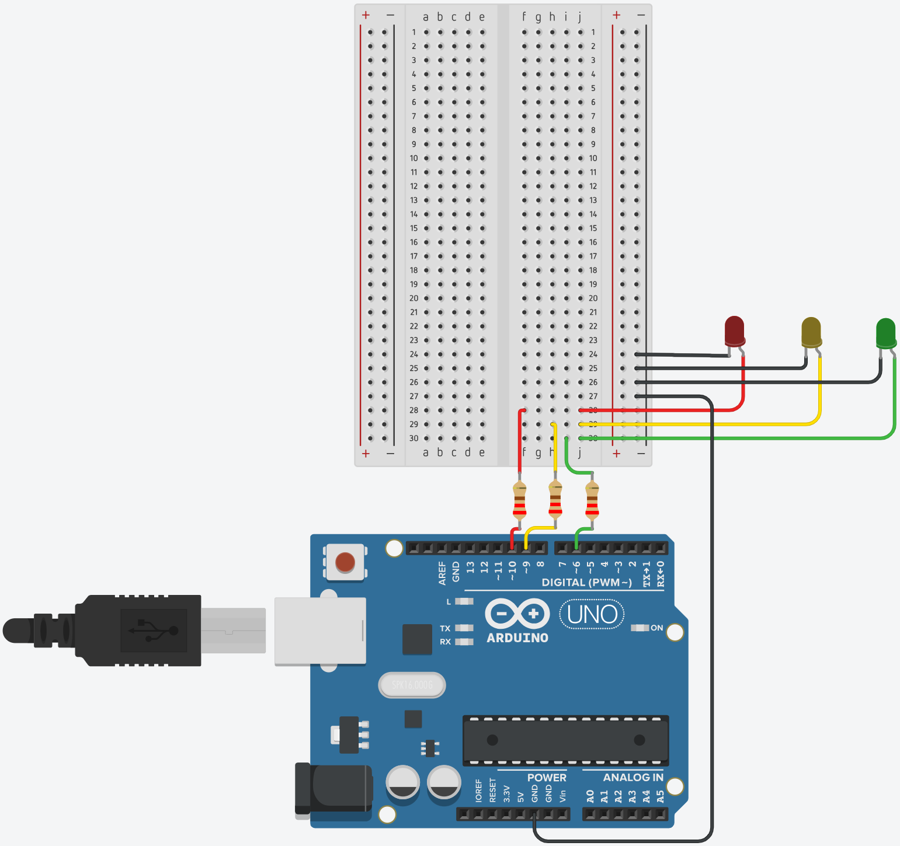
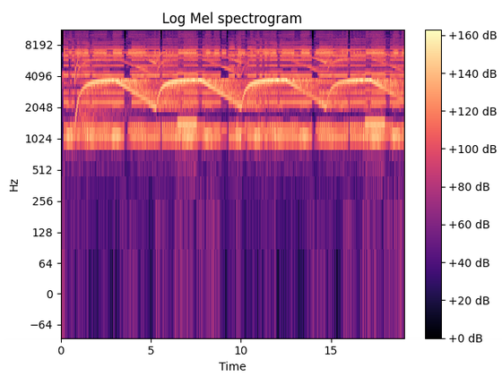
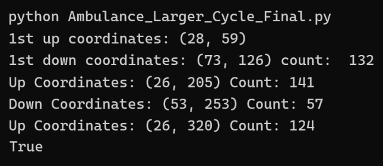
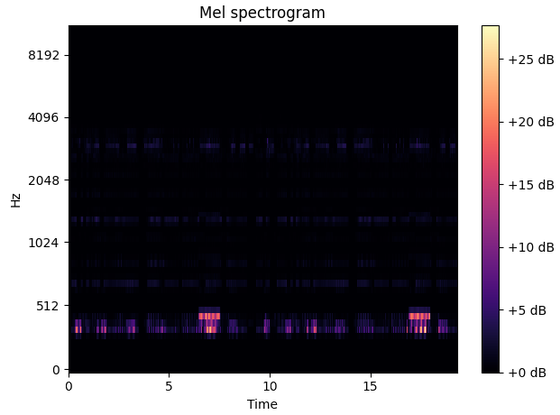
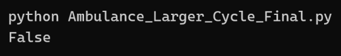

# Ambulance-Sound-Controlled Traffic Signal

Built a traffic-signal system that detects an **ambulance siren** from audio and holds the light green to let the ambulance through. Siren detection is done with traditional **audio + image processing**, and the signal is driven on an **Arduino** via `pyfirmata`.

This project was carried out as part of an internship at CSIR-National Aerospace Laboratories (NAL), Bengaluru from June - July 2023. 
<p align="center">
  
  <br><i>The Arduino traffic-signal prototype - red, yellow and green states.</i>
</p>

---

## How it works

### 1. Siren detection (signal + image processing)

Ambulance sirens sweep up and down in pitch in a regular, repeating pattern, mostly between about 650 and 1100 Hz, while most horns stay below 600 Hz. Detection turns the audio into an image and looks for that pattern:

1. **Frequency check.** If there is no sound above 600 Hz, the audio is classified as horn sound only.
2. **Audio → spectrogram.** The input `.wav` is converted to a **mel spectrogram** (64 mel bands, 1024-point FFT, hop length 320) with `librosa`, then to a log (dB) scale and saved as an image.
3. **Image processing.** The spectrogram is thresholded into a binary image (OpenCV), the region containing the siren is cropped out, and it is **skeletonized** (`skimage`) to reduce the siren's energy bands to single-pixel curves. Contours are then extracted and very small ones removed.
4. **Periodicity check.** The contour image is scanned for the alternating peaks and troughs of a siren. If they repeat for a fixed number of cycles, an ambulance siren is detected.

Two siren types are handled separately: the slow **wail** (needs about 15 s of audio) and the fast **yelp** (about 5 s).

<p align="center"></p>
<p align="center"><i>Wail siren: the log-mel spectrogram is thresholded and cropped to the siren band, skeletonized, and reduced to contours. The peaks and troughs left are counted to detect the siren.</i></p>

<p align="center"></p>
<p align="center"><i>Yelp siren: the same steps applied to its faster, sawtooth-shaped sweep.</i></p>

### 2. Traffic signal control (Arduino)

A three-LED traffic light is wired to an Arduino Uno running the StandardFirmata firmware and driven from Python with `pyfirmata`:

- **Normal operation** cycles the lights on a fixed schedule: red (5 s) → yellow (2 s) → green (5 s) → yellow → red.
- **On detection**, the signal switches to green (or stays green) and holds it while the siren is heard. Once only horn sound remains, the cycle resumes from where it was interrupted.

<p align="center"></p>
<p align="center"><i>Red, yellow and green LEDs on digital pins 10, 9 and 6, each through a 220 Ω resistor.</i></p>

---

## Results

The system was tested on recordings of both siren types, on sirens mixed with multiple horn sounds in the background (as in heavy traffic), and on horn sounds alone. Detecting a siren takes **under 4 seconds** from the input audio.

**Siren vs. horn.** On a siren recording, the detector finds the repeating peaks and troughs and returns `True`. On horn sound alone, there is no energy above 600 Hz, so it returns `False`.

<table align="center">
  <tr>
    <td align="center"></td>
    <td align="center" valign="middle"></td>
  </tr>
  <tr>
    <td align="center" colspan="2"><i>Siren input: peaks and troughs found, siren detected (<code>True</code>).</i></td>
  </tr>
  <tr>
    <td align="center"></td>
    <td align="center" valign="middle"></td>
  </tr>
  <tr>
    <td align="center" colspan="2"><i>Horn-only input: no sound above 600 Hz, no siren detected (<code>False</code>).</i></td>
  </tr>
</table>

**Full system.** The signal cycles normally until a siren is heard, then switches to green and holds it. When only horn sound remains, the cycle resumes from where it was interrupted. The logs below show the signal state at each update.

<p align="center"></p>
<p align="center"><i>Siren detected while the signal is red: it switches to green.</i></p>

<p align="center"></p>
<p align="center"><i>Siren gone, only horn sound: the normal cycle resumes from where it stopped.</i></p>

---

## Future work

The current system works on pre-recorded audio clips and controls a single traffic signal. To make it deployable at a real intersection, the next steps are:

- **Real-time detection** - recording audio live from microphones placed along the approach roads and processing it as it arrives, so the signal reacts while the ambulance is still approaching.
- **More sirens and signals** - extending detection to other siren types, and coordinating all the signals at an intersection so that the ambulance's direction turns green while the others turn red.
- **Standalone hardware** - running the detection and signal control together on a low-cost single-board computer such as a Raspberry Pi or Jetson Nano, so the system can work as an independent unit at the signal.

---

## Repository contents

| File | Description |
|------|-------------|
| `Arduino_Ambulance_Sound_Combined.py` | Full system - siren detection (wail and yelp) combined with Arduino LED control. |
| `Arduino_Traffic_Signal.py` | Standalone Arduino traffic-light cycle on a fixed schedule. |
| `Ambulance_Longer_Cycle.py` | Detection for the longer-cycle **wail** siren. |
| `Ambulance_Shorter_Cycle.py` | Detection for the shorter-cycle **yelp** siren. |

---

## Hardware & dependencies

**Hardware**
- Arduino Uno R3
- 3 LEDs (red, yellow, green) with 220 Ω resistors, breadboard

**Python libraries**
- `pyfirmata` - Arduino serial control
- `librosa` - audio loading and mel spectrogram
- `opencv-python` (`cv2`) - image thresholding, cropping, contours
- `scikit-image` - skeletonization
- `matplotlib`, `numpy`
- `keyboard` - select which test audio file to run

---

## Running it

1. Upload the **StandardFirmata** sketch to the Arduino and connect it (update the serial port in the script, e.g. `COM3`).
2. Wire the red/yellow/green LEDs to digital pins 10 / 9 / 6.
3. Point the script at your test siren `.wav` file(s).
4. Run:
   ```sh
   python Arduino_Ambulance_Sound_Combined.py
   ```

---

## References

- R. C. Gonzalez and R. E. Woods, *Digital Image Processing*, 4th ed.
- [Audio feature extraction notebook](https://github.com/PrabhjotKaurGosal/Helpful-scripts-for-MachineLearning/blob/main/AudioFeatureExtraction_vX.ipynb) - P. K. Gosal, *Helpful scripts for Machine Learning*
- [Retrieving pixel coordinates of a specific colour](https://answers.opencv.org/question/98980/how-to-retrieve-all-coordinates-of-pixels-of-specific-colour-in-an-image/) - OpenCV Q&A
- [Skeletonize](https://scikit-image.org/docs/stable/auto_examples/edges/plot_skeleton.html) - scikit-image documentation
